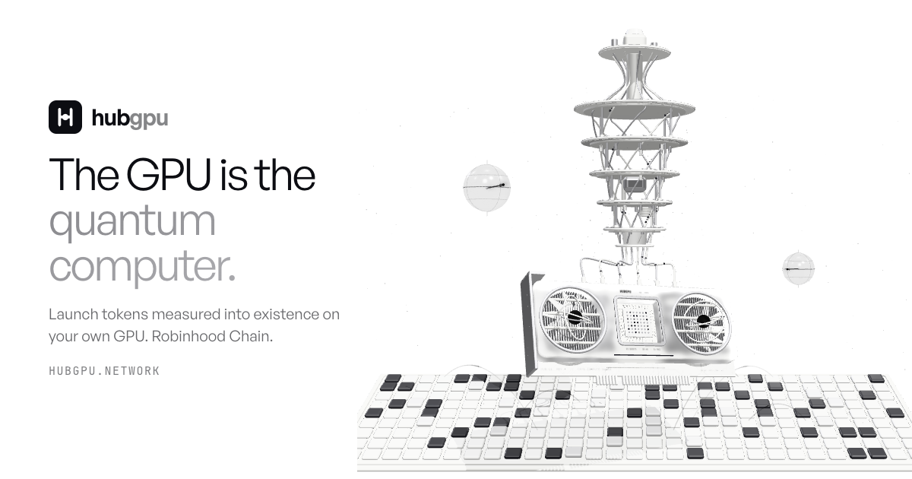
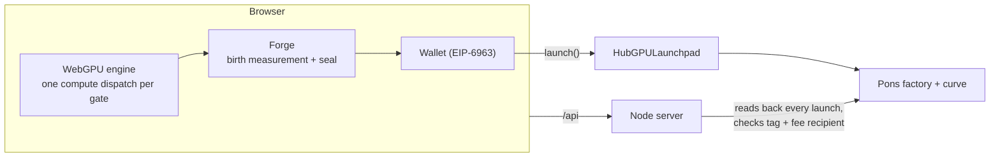

<p align="center"></p>

<h1 align="center">HubGPU</h1>

<p align="center"><b>The GPU is the quantum computer.</b><br>
Launch tokens measured into existence on your own graphics card. Robinhood Chain.</p>

<p align="center">
  <a href="https://hubgpu.network">hubgpu.network</a> ·
  <a href="https://hubgpu.network/app">App</a> ·
  <a href="https://hubgpu.network/docs">Docs</a> ·
  <a href="https://x.com/hubgpunetwork">@hubgpunetwork</a>
</p>

<p align="center">
  
  
  
  
  
</p>

---

An n-qubit quantum state is a list of 2ⁿ complex amplitudes. A GPU can hold that list in memory and apply gates to it exactly, so every graphics card is already a quantum simulator. HubGPU puts that to work in the browser, with nothing to install.

## Launchpad

A token on HubGPU is born from a measurement. Four steps, about a minute:

1. **Name** it and pick a ticker (checked against every token already born here).
2. **Measure** — your GPU builds a 12-qubit random circuit seeded by the name, ticker and a fresh nonce, computes all 4,096 amplitudes in WebGPU and samples the state once with the browser's cryptographic randomness. The outcome, e.g. `|0110 1000 0100⟩`, is the token's birth record. The shape of the distribution draws its **seal**: 64 porcelain tiles, black where the state was most likely, a ring where the measurement landed.
3. **Details** — description, X, Telegram, creator tax, and the required first buy (shown as tokens and % of supply).
4. **Launch** — a full cost breakdown and a wallet check, then one transaction through [`HubGPULaunchpad`](contracts/README.md). The page simulates it first; if it would fail, nothing is sent.

The token launches on **Pons** with the creator as fee recipient. `Born on HubGPU · |bits⟩` is written into its on-chain description, the seal is pinned to IPFS as its logo, and its website is its own page at `hubgpu.network/t/<address>`: seal, birth record, live market cap and curve, a candle chart built from the curve's own trades, holders, and a buy/sell box.

**My tokens** lists a wallet's launches and claims its creator fees in one go. A live strip shows births and trades as they happen.

### Fees

| | |
|---|---|
| Pons launch fee | read live from the factory (0.0005 ETH today) |
| HubGPU launch fee | 0.001 ETH, **free for $HGPU holders**, never above 0.01 ETH (contract cap) |
| First buy | from 0.0001 ETH, to the creator's wallet |
| Every trade | 1% Pons fee, 70% of it to the token's creator, plus the optional creator tax |

### $HGPU

Read from the chain, never from the page:

- **Free launches** — wallets holding 1,000,000 $HGPU pay no HubGPU fee (checked by the contract).
- **Rare seals** — the same wallets can birth from 16 qubits: a 16×16 seal on a black plate. The contract refuses a 16-bit birth from anyone else, so rarity is provable on-chain.
- **Featured** — creators holding 5,000,000 $HGPU have their tokens shown first.

## Quantum Lab

- **Composer** — place H, X, Y, Z, S, T, Rx/Ry/Rz, CNOT, CZ and Swap on up to 16 qubits. Every edit re-runs the statevector on your GPU and shows outcome probabilities, 1,024 sampled shots, the largest amplitudes and each qubit's Bloch vector (a shorter arrow means entanglement).
- **Qubit Test** — grows a random circuit from 12 qubits to the largest state your GPU will allocate and times every size. The ceiling is `n = ⌊log₂(VRAM ÷ 8 bytes)⌋`: 24 GB → 31 qubits, 80 GB → 33.
- **Leaderboard** — before a score is listed, the server sends a seed for a 14-qubit check circuit and compares your GPU's 16 most likely outcomes with its own exact float64 run (within 3·10⁻⁴). Correctness is verified; timing is self-measured and labelled so.

Browsers without WebGPU fall back to an exact CPU simulator.

## How it is built



The WebGPU engine keeps the statevector as `vec2<f32>` amplitudes in one storage buffer; each gate step's 2×2 unitary, target and control mask sit in a uniform buffer picked by dynamic offset, so a whole circuit is encoded into a single command buffer. A token joins the HubGPU registry only after the server reads its launch back from the chain: a Pons launch against ETH, carrying the birth tag, launched through `HubGPULaunchpad`, paying fees to the wallet that sent it.

```
public/
  index.html · js/scene.js           landing and the porcelain machine (three.js)
  app.html · js/app/
    engine.js                         WebGPU statevector (WGSL) + CPU fallback
    gates.js                          gate matrices, circuit compiler, float64 reference
    forge.js                          birth measurement and seal drawing
    launchpad.js · chain.js · wallet.js   wizard, launch, trade, fees, wallet
  token.html · js/app/token.js        token page: chart, trades, holders, buy/sell
  docs.html                           user docs
server.mjs · server/
  api.mjs                             qubit test challenge + leaderboard
  launchpad.mjs · pons.js · net.js    launch registry, Pons reads, RPC proxy, IPFS pin
contracts/                            HubGPULaunchpad (Foundry) — see contracts/README.md
tools/                                headless GPU check, fork end-to-end test
```

## Run it

Requires Node 20+.

```bash
npm install
node server.mjs              # http://127.0.0.1:9160
```

Open it in a browser with WebGPU (recent Chrome, Edge or Safari). The site uses [General Sans](https://www.fontshare.com/fonts/general-sans) (Fontshare, free licence); put `general-sans-400/500/600.woff2` in `public/fonts/` or it falls back to the system font.

Contracts:

```bash
cd contracts
forge install foundry-rs/forge-std --no-git
forge test --fork-url https://rpc.mainnet.chain.robinhood.com
```

## Roadmap

1. **Launchpad + Quantum Lab** — live.
2. **Compute Pools** — funding rounds in ETH for quantum research; GPU providers run the jobs and are paid by the second, rate-capped on chain.
3. **Proof-of-Qubit Mining** — idle GPUs simulate assigned circuits, answers spot-checked like the Qubit Test, rewards from $HGPU creator fees.

## Disclaimer

Tokens launched on HubGPU are created by their users; HubGPU does not vet or back them. Memecoins can go to zero. Nothing here is financial advice. $HGPU is a utility token with no claim on revenue.

## License

MIT. three.js and Lightweight Charts are vendored under their own licenses in `public/vendor/`.
