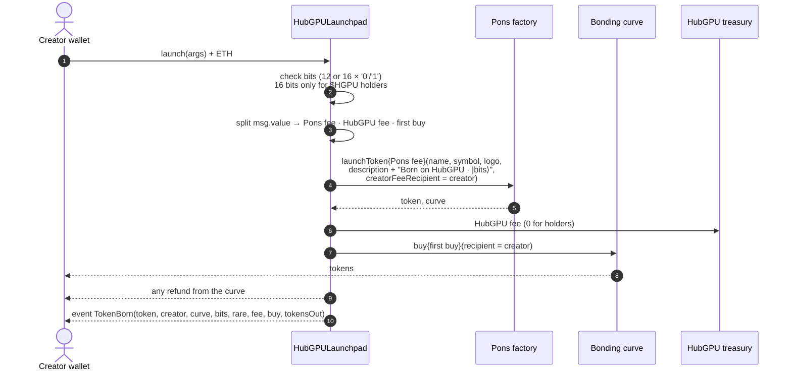
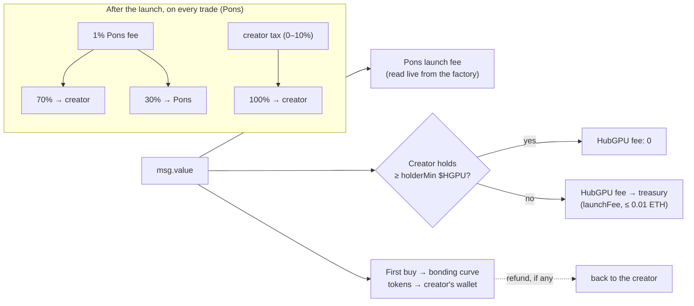

# HubGPULaunchpad

The on-chain door from [hubgpu.network](https://hubgpu.network) to [Pons](https://www.ponsfamily.com) on Robinhood Chain.

A creator's GPU measures a quantum circuit once in the browser. The outcome, a string of 12 bits (or 16 for a rare birth), is the token's birth record. `HubGPULaunchpad` launches the token on the Pons v2 factory, writes that record into the token itself, makes the creator's first buy straight into the creator's wallet, and takes HubGPU's flat launch fee, all in one transaction.

| | |
|---|---|
| Network | Robinhood Chain (chain id 4663) |
| Compiler | solc 0.8.26, optimizer 200 runs, EVM `cancun` |
| Source | [`src/HubGPULaunchpad.sol`](src/HubGPULaunchpad.sol) |
| Tests | [`test/HubGPULaunchpad.t.sol`](test/HubGPULaunchpad.t.sol): 14 tests against a fork of mainnet |
| Pons factory | [`0x7eD598BcEf8bd9Edd8C97A195C6d13f40801EC7e`](https://robinhoodchain.blockscout.com/address/0x7eD598BcEf8bd9Edd8C97A195C6d13f40801EC7e) |
| Deployed at | [`0xb6b5f0E3c1f34d99b55c8a406Ee3A21580AF2380`](https://robinhoodchain.blockscout.com/address/0xb6b5f0E3c1f34d99b55c8a406Ee3A21580AF2380?tab=contract) · verified on [Blockscout](https://robinhoodchain.blockscout.com/address/0xb6b5f0E3c1f34d99b55c8a406Ee3A21580AF2380?tab=contract) and [Sourcify](https://repo.sourcify.dev/4663/0xb6b5f0E3c1f34d99b55c8a406Ee3A21580AF2380) (exact match) |

---

## What one launch does



The contract ends every launch with a zero balance. If any step fails, the whole transaction reverts and nothing moves.

## Where the money goes



HubGPU earns only the flat launch fee. Creator fees and creator tax belong to the token's creator: Pons pays them to `creatorFeeRecipient`, which this contract always sets to the wallet that launched.

## $HGPU, enforced on-chain

| A wallet holding at least `holderMin` $HGPU | Everyone else |
|---|---|
| pays **no** HubGPU launch fee | pays `launchFee` (0.001 ETH at deployment) |
| may launch a **16-bit (rare)** birth | 12-bit births only (`RareNeedsHolder` otherwise) |

`isHolder(wallet)` reads the live balance with a guarded `balanceOf`; until the owner sets the holder terms it returns `false` for everyone. Because the contract refuses a 16-bit birth from anyone else, a rare token is provable from the chain alone: its `TokenBorn` event carries `rare = true`.

## Interface

### Launch

```solidity
struct LaunchArgs {
    string  name;
    string  symbol;
    string  logo;              // ipfs:// URI of the seal the creator's GPU drew
    string  description;       // "\n\nBorn on HubGPU · |bits⟩" is appended by the contract
    string  twitter;
    string  telegram;
    string  website;           // https://hubgpu.network/born/<id> → the token's page
    string  bits;              // 12 or 16 characters of '0' / '1'
    bytes32 salt;              // Pons CREATE2 salt
    bytes32 expectedEconomics; // pins the Pons terms shown to the creator; zero accepts current ones
    uint256 minTokensOut;      // slippage floor for the first buy
    uint16  creatorTaxBps;     // trade tax to the creator, capped by Pons
}

function launch(LaunchArgs calldata a) external payable
    returns (address token, address curve, uint256 tokensOut);
```

`msg.value` = Pons launch fee + `feeFor(msg.sender)` + first buy. The first buy must be at least `minOpeningBuy` (0.0001 ETH) and at most 1 ETH. The page reads all three amounts from `terms()` and simulates the call before asking the wallet to sign.

### Views

| Function | Returns |
|---|---|
| `terms(wallet)` | `(fee, ponsFee, minBuy, holder, paused)`: everything the page needs in one call |
| `feeFor(wallet)` | the HubGPU fee this wallet pays right now |
| `isHolder(wallet)` | whether the wallet holds at least `holderMin` $HGPU |
| `tokenCount()`, `tokens(i)`, `creatorOf(token)` | every token launched through this contract and who launched it |
| `launchFee`, `minOpeningBuy`, `holderToken`, `holderMin`, `treasury`, `owner`, `paused` | current settings |

### Owner

| Function | Bound |
|---|---|
| `setLaunchFee(fee)` | never above `MAX_LAUNCH_FEE` = **0.01 ETH** |
| `setMinOpeningBuy(amount)` | between 0.00001 and 1 ETH |
| `setHolderTerms(token, min)` | the $HGPU contract and the minimum (in wei: 1,000,000 $HGPU = `1_000_000e18`) |
| `setFeeExempt(wallet, bool)` | wallets that never pay the fee |
| `setTreasury(address)` | non-zero |
| `setPaused(bool)` | stops new launches; existing tokens are unaffected |
| `transferOwnership` → `acceptOwnership` | two steps, so a typo cannot lose the contract |

### Events

```solidity
event TokenBorn(address indexed token, address indexed creator, address curve, string bits, bool rare,
                uint256 feePaid, uint256 firstBuy, uint256 tokensOut, uint16 creatorTaxBps);
event LaunchFeeChanged(uint256 fee);
event HolderTermsChanged(address token, uint256 min);
event TreasuryChanged(address treasury);
event MinOpeningBuyChanged(uint256 amount);
event FeeExemptChanged(address indexed wallet, bool exempt);
event PausedChanged(bool paused);
event OwnershipTransferStarted(address indexed previousOwner, address indexed newOwner);
event OwnershipTransferred(address indexed previousOwner, address indexed newOwner);
```

### Errors

| Error | When |
|---|---|
| `BadBits()` | the birth record is not 12 or 16 characters of `0` / `1` |
| `RareNeedsHolder()` | a 16-bit birth from a wallet below `holderMin` |
| `FirstBuyRequired()` | `msg.value` does not cover the fees plus the minimum first buy |
| `BadValue()` | first buy above 1 ETH, creator tax above the Pons cap, or an owner setting out of bounds |
| `LaunchesPaused()` | the owner paused new launches |
| `NotOwner()`, `ZeroAddress()`, `Reentrant()`, `TransferFailed()` | as named |

## Security properties

- **Keeps nothing.** Every launch ends with a zero balance: fees out, buy into the curve, refund to the creator. `receive()` accepts ETH only during a launch (the curve's refund); a direct transfer reverts.
- **Cannot touch anyone's funds.** There is no withdraw, sweep or arbitrary-call function. The owner cannot move a creator's ETH, tokens or creator fees.
- **Creator fees go to the creator.** `creatorFeeRecipient` is always `msg.sender`; there is no parameter to redirect it.
- **The creator buys first.** The first buy lands in the creator's wallet in the launch transaction, and the creator is exempt from Pons's snipe tax on it.
- **Bounded owner.** The fee can never exceed 0.01 ETH; all other owner powers are settings, and every change emits an event.
- **No reentrancy.** `launch` holds a lock for its whole duration.
- **Slippage protection.** `minTokensOut` floors the first buy; the page sets it to 90% of a simulated result.
- **No upgrade path.** The contract is not a proxy; what is verified is what runs.

## Tests

The suite runs against a fork of Robinhood Chain mainnet, so the real Pons factory and curves launch the tokens.

```bash
forge install foundry-rs/forge-std --no-git     # first time only
forge test --fork-url https://rpc.mainnet.chain.robinhood.com -vv
```

| Test | Proves |
|---|---|
| `test_launchPaysFeeToTreasuryAndWritesBirth` | fee reaches the treasury, first buy reaches the creator, the birth record is in the description, Pons pays creator fees to the creator, the contract keeps nothing |
| `test_holderLaunchesFree` | a holder pays no HubGPU fee |
| `test_holderBelowMinimumPays` | one token short of the minimum still pays |
| `test_rareBirthNeedsHolder` | 16 bits revert for a non-holder and succeed for a holder |
| `test_badBitsRejected` | 11 bits, a `2`, 13 bits all revert |
| `test_firstBuyRequired` | one wei short of the minimum reverts |
| `test_extraValueBecomesPartOfTheBuy` | extra ETH buys more tokens, nothing is left behind |
| `test_feeIsCappedAndOwnerOnly` | only the owner sets the fee, never above 0.01 ETH |
| `test_feeExemptWallet` | exempt wallets pay nothing |
| `test_pause` | paused launches revert |
| `test_termsView` | `terms()` reports fee, Pons fee, minimum and holder status |
| `test_rejectsDirectEth` | plain transfers to the contract revert |
| `test_twoStepOwnership` | ownership moves only when the new owner accepts |
| `test_constructorRejectsFeeAboveCap` | the cap holds from deployment |

## Deploy and verify

```bash
forge build
forge create src/HubGPULaunchpad.sol:HubGPULaunchpad \
  --rpc-url https://rpc.mainnet.chain.robinhood.com --broadcast --interactive \
  --constructor-args 0x7eD598BcEf8bd9Edd8C97A195C6d13f40801EC7e <owner> <treasury> 1000000000000000

forge verify-contract <address> src/HubGPULaunchpad.sol:HubGPULaunchpad \
  --chain 4663 --verifier sourcify \
  --constructor-args $(cast abi-encode "c(address,address,address,uint256)" 0x7eD598BcEf8bd9Edd8C97A195C6d13f40801EC7e <owner> <treasury> 1000000000000000)
```

The standard-JSON input used for verification is in [`verify/HubGPULaunchpad.standard-input.json`](verify/HubGPULaunchpad.standard-input.json).

## License

MIT
